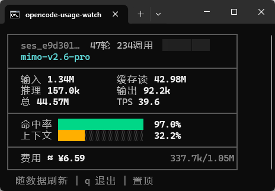
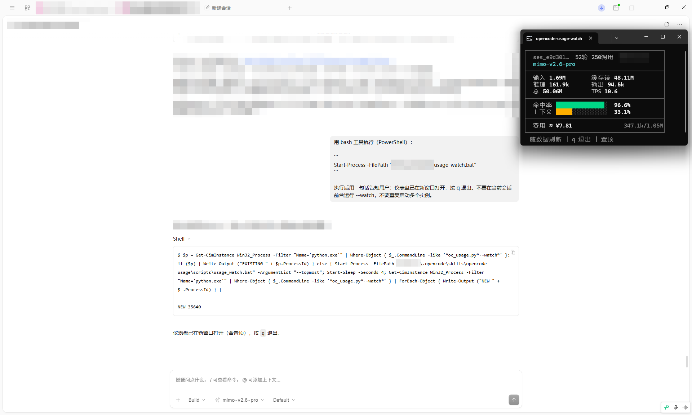

# opencode-usage-windows

opencode 用量与计费透明化工具：token 报表、缓存命中率、TPS、上下文占比、费用估算，外加独立窗口实时仪表盘。**主打简洁省事**：零依赖、零配置、装完即用，一个窗口看清用量/命中率/费用。只读本地数据，零 token 开销。

> 名称带 `-windows`：仪表盘的启动器（`.bat`）、窗口置顶、按 `q` 退出等能力以 Windows
> 为主，且在 Windows 上开发与验证。脚本含跨平台降级（其他平台清屏用 `clear`、退出用
> Ctrl+C），但 **Linux/macOS 未做兼容性实测**，报表功能同理；欢迎实测反馈。skill 目录名
> 保持 `opencode-usage`。





## 动机

opencode 自带面板给的是「最近一次调用」的 token 快照：没有会话累计、没有缓存命中率，费用还常因供应商定价缺失显示为 0。按量计费时代，「这场对话到底花了多少钱、缓存省了多少」应该一眼可见——本工具补上这块。

## 功能

- `/usage` 报表：按天/模型/会话汇总五类 token、缓存命中率、人民币费用
- `/watch` 仪表盘：独立窗口实时显示当前会话累计 token、命中率、上下文占比、TPS、费用
- 价格表外置（`prices.json`），换模型加一段配置即可；未配置价显示「缺省」，绝不乱估

## 安装

**项目级**（只在本项目生效）：

```
skills/opencode-usage/  →  <你的项目>/.opencode/skills/opencode-usage/
command/*.md            →  <你的项目>/.opencode/command/
```

**全局**（所有项目生效）：拷到 `~/.config/opencode/skills/` 与 `~/.config/opencode/command/`（Windows：`%USERPROFILE%\.config\opencode\`）。opencode 的 TUI 与 desktop 版通用。

## 使用

```
/usage                # 会话用量报表（可带参数：--days 7 --by model）
/watch                # 新窗口打开实时仪表盘，按 q 退出
```

或直接 `python scripts/oc_usage.py --help`（脚本在 skill 的 scripts/ 下）。

单屏用户可加 `--topmost` 让仪表盘窗口置顶，不遮挡问题立刻消失：

```
usage_watch.bat --topmost          # 或 python scripts/oc_usage.py --watch --topmost
```

注意：置顶是**窗口级**属性，无法只置顶单个标签页——如果终端把仪表盘放在多标签的同一个
窗口里，整个窗口都会置顶。仪表盘默认弹独立窗口，通常无此问题；若你的终端复用标签，
建议单独开一个终端窗口运行。

## 刷新策略

仪表盘轮询本地库（默认 2 秒一次，`--interval` 可调），**仅在数据变化时重绘**——观感上等同事件驱动：数字随对话即时跟上，无对话时画面完全静止，不闪烁、不空转。

## 仪表盘字段

| 字段 | 含义 |
|---|---|
| 输入/缓存读/推理/输出/总 | **会话累计** token（缓存写多数供应商不上报，恒为 0，故不显示） |
| 命中率 | 缓存读 ÷ (缓存读+未命中输入)，绿色条 |
| 上下文 | 最近一次调用的上下文占用 ÷ 模型上限，黄色条。上限取值顺序：本地 `opencode.json` 的 `limit.context`（只读解析）→ 内置默认表 → 1,048,576 |
| TPS | 最近 5 次调用的生成速度（推理+输出）token/秒 |
| 费用 | 人民币估算，推理按输出价；未配置价显示「缺省」 |

**与 opencode 自带面板的差异**：面板的「总 token / 输入 / 输出…」是最近一次调用的**快照**（分解当前上下文的构成），本工具是**会话累计**，数量级天然不同；「上下文」口径两者一致。面板「总成本」以美元计且不含推理 token，本工具以人民币计且推理按输出价——金额不同属正常，以本工具为准。

## 换其他模型时如何导入计费

内置价格表以**人民币**为例（来源标注在 `prices.json` 的 `_source` 字段：MiMo 官方定价页、
查询日期、哪些条目是近似值）。**币种不限**——表的单位就是「你所选币种/百万 token」，
费用列符号由 `_currency` 字段决定（默认 `¥`）。价格会变动，请以供应商官方定价页为准手工维护。

1. 打开 `scripts/prices.json`，仿照示例加一段：
   `"模型id前缀": {"miss": 未命中输入, "cache_read": 缓存读, "cache_write": 缓存写, "output": 输出}`
   单位**所选币种/百万 token**，推理 token 按输出价并入 `output`。
2. 前缀匹配，长的优先（例如 `mimo-v2.6-pro` 不会被 `mimo-v2.6` 抢走）。
3. 不填也行：费用显示「缺省」，token 统计照常。
4. 以美元计价为例：条目直接填美元价，`_currency` 改为 `"$"`，即可全程美元统计。

可选自动化：`python scripts/sync_prices.py --provider xxx --rate 6.6747` 从 models.dev
拉公开 USD 价补全缺失条目。**独立联网脚本，运行前会二次确认**（`--yes` 跳过交互、
`--dry-run` 仅预览）；只补缺不覆盖手工条目。这里的 `--rate` 是 **USD→你目标币种** 的汇率
（其他币种自行换算；脚本内置建议值 6.6747，来源 finscope 2026-10-23 UTC+8 02:35，
汇率随行情变动，请以当日为准），需人工指定、不联网拉取实时汇率——换算价仅作初稿，
请按官方价核对后覆盖。不需要联网功能可直接删除该文件，主工具 `oc_usage.py` 零联网、不受影响。

## 安全说明

- 主工具只读 opencode 本地库（SQLite `mode=ro`）与本地配置的 `limit.context`（纯 JSON 读取），不写任何文件、**零网络调用**
- `scripts/sync_prices.py` 是唯一的联网文件：独立、可删除，运行前二次确认，只补缺不覆盖
- 无 API key、无遥测；不读 `auth.json`
- 不管理进程（不 kill 任何进程）；多开会开多个仪表盘窗口，自行关闭即可
- 报表 `--by session` 显示会话标题片段，截图分享注意隐私
- 发布/分发时勿打包含 API key 的 `opencode.json` / `auth.json`

## 编码与终端兼容

- 颜色：启动时探测 Windows VT；不支持则自动无色，不输出转义符垃圾
- 框线/进度条字符：老式控制台或缺字体时用 `--ascii`（或 `OC_USAGE_ASCII=1`）切 ASCII 界面
- 输出统一 UTF-8（`errors="replace"`），GBK 管道/重定向不会崩溃
- 清屏用 `cls`/`clear`（按系统），不用 ANSI 清屏（conhost 下会导致帧下移）
- `.bat` 文件**内容**保持纯 ASCII + CRLF：cmd 按 GBK 代码页解析批处理，UTF-8 中文字面量的尾字节会与行尾字节误配对，导致换行错位、命令拆行。**路径不需要全英文**——bat 用 `%~dp0` 运行时展开自身目录，含中文的安装路径正常工作；要避免的只是写死在 bat 文本里的中文（如标题、注释）

## 文件结构

```
opencode-usage-windows/               ← 仓库（zip 内同名顶层目录）
├── README.md                      ← 本文件（仓库根）
├── skills/opencode-usage/
│   ├── SKILL.md                   ← agent 触发词与用法
│   ├── README.md                  ← 同本文件（skill 内副本）
│   └── scripts/
│       ├── oc_usage.py            ← 主工具（零联网）
│       ├── prices.json            ← 价格表（元/百万 token）
│       ├── sync_prices.py         ← 可选联网补价（不需要可删）
│       └── usage_watch.bat        ← Windows 仪表盘启动器
└── command/
    ├── usage.md                   ← /usage 入口
    └── watch.md                   ← /watch 入口
```

## License

MIT
